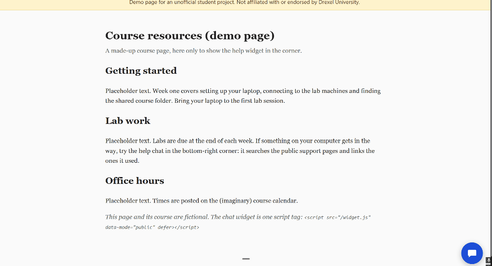
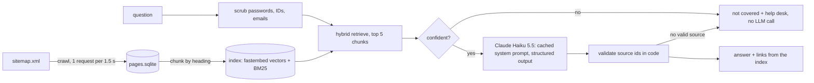

# SCIS Help Assistant

[](https://github.com/kevfang03/scis-help-assistant/actions/workflows/ci.yml)

Describe an IT problem in your own words; get a short answer from the public SCIS support pages, with a numbered link to every page it used, or an honest "not covered" and the help desk.

> **Unofficial student project. Not affiliated with or endorsed by Drexel University.** It uses only the public pages of [support.cci.drexel.edu](https://support.cci.drexel.edu/) and is not deployed on any Drexel site. SCIS is Drexel's College of Computing & Informatics (formerly CCI); the support site still uses both names.

## Demo



The GIF shows the local demo page only (a plain, invented "course resources" page with the widget). A student opens the chat bubble and asks a VPN or printing question; the answer cites its pages as [1], [2] with links. An off-topic question ("best pizza near campus") gets "not covered" and the help-desk link, and the desk view at `/desk` lists every other page it retrieved under "Also retrieved".

## What it does

- **Ask in your own words** ("my vpn keeps disconnecting at home"). The assistant finds the matching support pages by meaning, answers in a few sentences or steps, and links every page it used as [1], [2]. The links come from its own index, never from the model.
- **Says when it doesn't know.** If the pages don't cover the question (or it isn't about SCIS IT support at all), it says "The SCIS support pages don't cover this" and points to the help desk instead of guessing. At most one clarifying question per conversation ("Are you on campus Wi-Fi or at home?").
- **Desk mode** for student assistants on shift: more technical detail, and every retrieved page listed, with the unused ones under "Also retrieved". Same engine, same index; local only.
- **Two ways to use it:** a CLI (`uv run scis-help "question"`) and a local web app with an embeddable chat-bubble widget, added to any local page with one tag:

  ```html
  <script src="http://127.0.0.1:8765/widget.js" data-mode="public" defer></script>
  ```

- **Feedback and gaps:** "Did this help? 👍/👎" per answer, and a local report of the questions the pages didn't cover (counts and scrubbed text only), so missing docs show up.

An example of the CLI (written by hand for this README, not real output):

```text
> uv run scis-help "how do I connect to the VPN from home?"
The VPN lets you reach campus resources from home. Install it from `vpn.drexel.edu` by
signing in with your Drexel credentials and approving the two-factor prompt [1].

Sources:
[1] VPN — https://support.cci.drexel.edu/service-catalog/network-connectivity/vpn/
```

## How it works



- **Local embeddings plus BM25, fused with RRF.** `fastembed` (`BAAI/bge-small-en-v1.5`, CPU, free, offline after one download) finds meaning; BM25 catches exact names like "GlobalProtect" or "CS 265". Reciprocal Rank Fusion merges the two lists. ([D1](docs/ARCHITECTURE.md#d1-embeddings-and-index-local-fastembed--bm25-hybrid-brute-force-numpy-decided-2026-10-18))
- **No vector database.** 690 pages make 1,027 chunks, about 1.5 MB of vectors; one numpy matrix product searches them in milliseconds. ([D1](docs/ARCHITECTURE.md#d1-embeddings-and-index-local-fastembed--bm25-hybrid-brute-force-numpy-decided-2026-10-18))
- **A confidence gate before any paid call.** If the best dense score is below 0.65 (tuned on the dev split), the answer is "not covered" with no LLM call. ([D1](docs/ARCHITECTURE.md#d1-embeddings-and-index-local-fastembed--bm25-hybrid-brute-force-numpy-decided-2026-10-18))
- **The cheapest model, cached.** Claude Haiku 5.5 with effort `low`; the fixed 1,882-token system prompt is read from cache on every call, and only the sources and question vary. ([D4](docs/ARCHITECTURE.md#d4-answering-decided-2026-10-18))
- **Source ids validated in code.** The model cites `[S1]`…`[S5]`; unknown ids are dropped, and an answer with no valid source becomes "not covered". ([D4](docs/ARCHITECTURE.md#d4-answering-decided-2026-10-18))
- **Links only from the index.** Every link shown comes from the metadata of a chunk the model was given; URLs the model writes are removed, except a host name copied verbatim from a source, kept as plain text. ([D4](docs/ARCHITECTURE.md#d4-answering-decided-2026-10-18), [Governance](docs/GOVERNANCE.md#grounding-and-citations))
- **Scrubbing first.** Passwords, Drexel IDs, user ids, emails and phone numbers are replaced before retrieval, the LLM call and any log. ([D7](docs/ARCHITECTURE.md#d7-scrubbing-decided-2026-10-18))
- **A Shadow-DOM widget.** One vanilla-JS file, no build step; the host page's CSS can't break it, and answers are rendered server-side from a small safe markdown subset. ([D5](docs/ARCHITECTURE.md#d5-web-app-and-widget-decided-2026-10-18))

## Evaluation

Hand-written questions in [`evals/questions.yaml`](evals/questions.yaml), each with the page(s) that should answer it, or `not_covered` for out-of-scope ones. **Dev** (16 in-scope + 4 out-of-scope) was used for tuning. **Holdout** (8 + 2) was run once and never tuned on. **Owner** (8 + 2) are new questions the project owner wrote in students' real phrasing (from memory, never from tickets), run once after all tuning. Measured on 2026-10-21:

| | hit@3 | Answered (in-scope) | Not-covered accuracy | Citation hit | Groundedness (partial) |
|---|---|---|---|---|---|
| Dev, first run | 94% | 94% | 100% | 88% | 40% (60%) |
| Dev, after tuning | 94% | 100% | 100% | 94% | 88% (12%) |
| Holdout (run once) | 75% | 88% | 100% | 75% | 57% (43%) |
| Owner-written questions (run once) | 75% | 62% | 100% | 62% | 80% (20%) |
| Dev, after URL fix | 94% | 100% | 100% | 94% | 81% (19%) |

- **hit@3:** share of in-scope questions with an expected page among the top 3 retrieved pages (retrieval only, no LLM).
- **Answered (in-scope):** share of in-scope questions that got an answer, not "not covered", a clarifying question or links only.
- **Not-covered accuracy:** share of out-of-scope questions answered "not covered".
- **Citation hit:** share of in-scope questions whose answer cites at least one expected page.
- **Groundedness (partial):** share of answered questions that a Claude Haiku judge rates fully supported by the excerpts they cite; in brackets, the share rated partly supported.

Caveats:
- **The judge changed during tuning.** Part of the dev groundedness jump from 40% to 88% is a judge change, not a model change: the judge stopped counting omissions as unsupported and treats SCIS and CCI as the same college. The judge is also the same model family as the answerer.
- **"Dev, after URL fix"** is one rerun after answers started keeping host names copied verbatim from a source. Its 81% groundedness is a separate measurement and replaces none of the rows above; its three partial verdicts were about step details, not URLs.
- **Holdout misses:** retrieval missed own-laptop printing (it found the Commons printing pages) and Echo360 playback; one answer was a clarifying question ("Windows or macOS?").
- **Owner-question misses:** retrieval missed Wi-Fi dropping on campus and connecting to the Linux server from home, and both answers were clarifying questions, which count as not answered because the eval doesn't reply to them. For the CS Linux password reset, retrieval ranked an expected page first but the model said "not covered".
- The sets are small (8–16 in-scope questions each, and groundedness counts only answered ones), so one question can move a percentage by 6–20 points.

**Cost:** about $0.0004 per answered question ([estimate](docs/ARCHITECTURE.md#cost-estimate)). Measured eval runs with the judge: $0.0114 for the 20 dev questions and $0.0043 for the 10 owner questions. The whole payload 02 day, 131 calls including every eval run, cost about $0.045. Retrieval evals are free.

## Responsible use

- **Public pages only.** No ticket data, student data or internal wiki text, in the repository or anywhere else. ([data](docs/GOVERNANCE.md#data-sources-and-where-things-are-stored))
- **A polite crawler:** sitemap pages only, `robots.txt` checked every crawl, 1.5 s between requests, a User-Agent that names the project. ([crawl policy](docs/GOVERNANCE.md#crawl-policy))
- **Private input stays out:** the widget asks users not to enter passwords or IDs, every message is scrubbed first, and no IPs, session ids or user agents are stored. ([privacy](docs/GOVERNANCE.md#user-input-privacy))
- **Grounded answers or none:** validation in code, links only from the index, "not covered" plus the help desk otherwise. ([grounding](docs/GOVERNANCE.md#grounding-and-citations))
- **Capped spending:** confidence gate, the cheapest model, prompt caching, a daily token budget, per-session and per-client limits. ([cost](docs/GOVERNANCE.md#cost-controls))
- **Not a help-desk replacement,** and the pages can be out of date. ([limitations](docs/GOVERNANCE.md#limitations))

## Setup

Needs Python 3.12 (uv installs it) and about 23 minutes for the first crawl. Answers need an Anthropic API key; **without one it still returns the most relevant pages as links.**

### Windows (PowerShell)

1. Install uv:

   ```powershell
   powershell -ExecutionPolicy ByPass -c "irm https://astral.sh/uv/install.ps1 | iex"
   ```

2. Get the code and go into the folder:

   ```powershell
   git clone https://github.com/kevfang03/scis-help-assistant.git
   ```

   ```powershell
   cd scis-help-assistant
   ```

3. Install the dependencies:

   ```powershell
   uv sync
   ```

4. Crawl the public support pages (about 23 minutes; one request every 1.5 s):

   ```powershell
   uv run scis-help crawl
   ```

5. Build the index (the first run downloads the ~70 MB embedding model):

   ```powershell
   uv run scis-help index
   ```

6. Save your API key in Windows Credential Manager (hidden prompt; use a key with a spend limit):

   ```powershell
   uv run scis-help llm set-key
   ```

7. Ask a question:

   ```powershell
   uv run scis-help "how do I connect to the VPN?"
   ```

8. Start the local web app with the chat widget (opens `http://127.0.0.1:8765/`; stop with Ctrl+C):

   ```powershell
   uv run scis-help web
   ```

9. Check retrieval on the dev questions (free):

   ```powershell
   uv run scis-help eval retrieval --split dev
   ```

### macOS (Terminal)

1. Install uv:

   ```bash
   curl -LsSf https://astral.sh/uv/install.sh | sh
   ```

2. Get the code and go into the folder:

   ```bash
   git clone https://github.com/kevfang03/scis-help-assistant.git
   ```

   ```bash
   cd scis-help-assistant
   ```

3. Install the dependencies:

   ```bash
   uv sync
   ```

4. Crawl the public support pages (about 23 minutes; one request every 1.5 s):

   ```bash
   uv run scis-help crawl
   ```

5. Build the index (the first run downloads the ~70 MB embedding model):

   ```bash
   uv run scis-help index
   ```

6. Save your API key in the macOS Keychain (hidden prompt; use a key with a spend limit):

   ```bash
   uv run scis-help llm set-key
   ```

7. Ask a question:

   ```bash
   uv run scis-help "how do I connect to the VPN?"
   ```

8. Start the local web app with the chat widget (opens `http://127.0.0.1:8765/`; stop with Ctrl+C):

   ```bash
   uv run scis-help web
   ```

9. Check retrieval on the dev questions (free):

   ```bash
   uv run scis-help eval retrieval --split dev
   ```

Page text, the index and logs live in your user data folder (`uv run scis-help status` prints it), never in the repository.

## Commands

| Command | What it does | Options |
|---|---|---|
| `scis-help "question"` or `scis-help ask "question"` | Answer from the support pages | `--desk` (more detail, every retrieved page), `--no-feedback` (skip "Did this help?") |
| `scis-help crawl` | Fetch new and changed pages from the sitemap | `--full` (refetch every page), `--max-pages N` |
| `scis-help index` | Rebuild the search index from the stored pages | |
| `scis-help search "query"` | Show the best-matching pages, no LLM | `--k N` (results, default 5), `--desk` |
| `scis-help status` | Data folder, page count, index (no network) | |
| `scis-help llm set-key` | Save the API key in the system keychain (hidden prompt) | |
| `scis-help llm status` | Settings, whether a key is saved, today's usage (no network) | |
| `scis-help llm test` | One tiny API call | |
| `scis-help gaps` | Questions the pages didn't cover, most frequent first | `--days N` (default 30) |
| `scis-help feedback` | "Did this help?" totals and the 👎 list | `--days N` (default 30) |
| `scis-help eval retrieval` | hit@3, hit@5, MRR and the gate (free) | `--split dev\|holdout\|owner\|all`, `--include-owner` (with `all`), `--questions PATH` |
| `scis-help eval answers` | The full engine on the eval questions (paid; asks first) | the `eval retrieval` options, `--judge` (groundedness), `--yes` (don't ask) |
| `scis-help web` | The local web app and widget (`/` demo, `/desk` desk mode) | `--host`, `--port` (default 127.0.0.1:8765), `--no-browser` |

Put `-v` / `--verbose` before any command for debug logging on stderr (`scis-help -v crawl`). `--split all` leaves the owner split out unless `--include-owner` is given.

## Configuration

Every setting has a default; [`.env.example`](.env.example) lists them all with comments. Copy it to `.env` or set environment variables (`SCIS_HELP_` prefix, `__` between section and name). The API key is never a setting: it lives only in the system keychain. The ones people change most:

| Setting | Default | What it does |
|---|---|---|
| `SCIS_HELP_LLM__DAILY_TOKEN_BUDGET` | `200000` | Tokens per local day before calls stop (cache reads count at 10%) |
| `SCIS_HELP_LLM__ENABLED` | `true` | `false` gives links only, no API calls |
| `SCIS_HELP_RETRIEVAL__MIN_SCORE` | `0.65` | The confidence gate; below it, "not covered" without an LLM call |
| `SCIS_HELP_ANSWER__HELP_CONTACT` | the support home page | Who to contact when the pages don't cover a question |
| `SCIS_HELP_WEB__PORT` | `8765` | Port of the local web app |
| `SCIS_HELP_WEB__ALLOWED_ORIGINS` | empty | Local pages allowed to embed the widget (CORS) |

## Project layout

```text
src/scis_help/
  cli.py        the scis-help command
  common/       config, paths, logging, exit codes, TLS, scrubber
  sources/      the support-site crawler and extractor
  index/        chunking, embeddings, BM25, the store, hybrid retrieval
  llm/          the Claude API client, budget, usage log, keychain
  answer/       the answer engine, prompts, data shapes
  web/          FastAPI app, safe rendering, rate limits, sessions, static widget files
  feedback/     the unanswered-questions log and "Did this help?"
  eval/         retrieval and answer metrics
evals/          questions.yaml (results are written to evals/results/, gitignored)
tests/          mirrors src/; fixtures/ holds small synthetic HTML in the site's shape
docs/           ARCHITECTURE.md, GOVERNANCE.md, OPEN_QUESTIONS.md, payloads/
```

## Tests and CI

```bash
uv run ruff check .
```

```bash
uv run ruff format --check .
```

```bash
uv run pytest -q
```

The tests never touch the network: the Claude SDK, the HTTP transport and the embedder are faked, every socket connection fails, and the keychain is an in-memory fake. [GitHub Actions](.github/workflows/ci.yml) runs ruff on Ubuntu and pytest on Ubuntu, Windows and macOS on every push and pull request, with no secrets.

## Licence

[MIT](LICENSE).

## Built with

Python 3.12, [uv](https://docs.astral.sh/uv/), [fastembed](https://github.com/qdrant/fastembed), [bm25s](https://github.com/xhluca/bm25s), [FastAPI](https://fastapi.tiangolo.com/), and the [Anthropic API](https://docs.anthropic.com/) with Claude Haiku 5.5.

Built with an AI-assisted architect/worker workflow: an architect session made the design decisions with the owner and wrote one execution payload per step, and worker sessions implemented them. The payloads are in [`docs/payloads/`](docs/payloads/).
